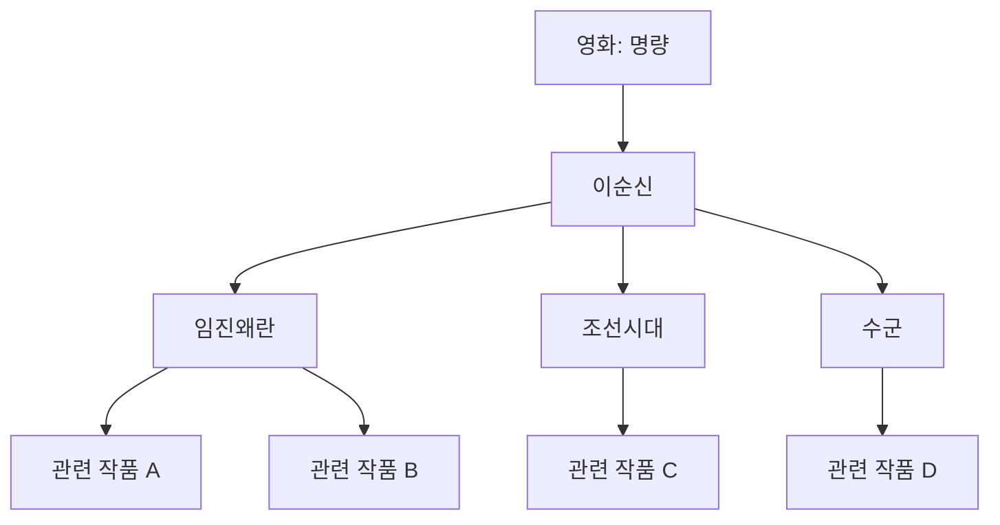
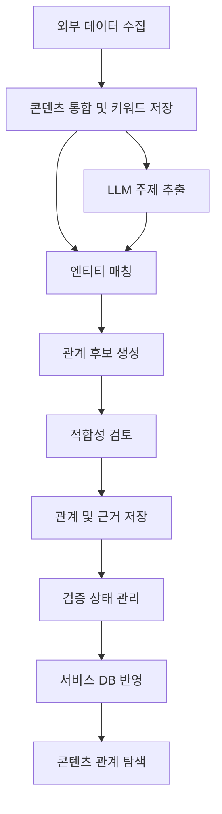

## 데이터베이스 구조

PostgreSQL을 사용하여 영화·드라마·도서 데이터를 통합 관리하고, 작품과 인물·사건·장소·주제 등의 관계를 구축한다.

현재 **개발 DB는 총 27개 테이블**, **GCP 서비스 DB는 핵심 11개 테이블**로 구성되어 있다.

### 1. 전체 테이블 구성

| 구분 | 주요 테이블 | 역할 |
|---|---|---|
| 원본 데이터 | `raw_kmdb_movie`, `raw_tmdb_movie`, `raw_tmdb_tv`, `raw_yes24_book`, `raw_data4library_book` | 외부 API 원본 데이터 보관 |
| 콘텐츠 | `content`, `movie_detail`, `tv_detail`, `book_edition` | 영화·드라마·도서의 기본 및 상세 정보 |
| 출처·키워드 | `content_source_map`, `content_keyword` | 외부 ID 매핑 및 작품별 키워드 관리 |
| LLM 주제 | `topic`, `content_topic`, `content_topic_extraction_run`, `content_topic_extraction_result`, `content_topic_extraction_status` | LLM 주제 추출 결과 및 실행 이력 |
| 엔티티 | `entity`, `entity_alias`, `entity_relation`, `entity_type_change_log` | 인물·사건·장소·주제 등의 개념과 관계 |
| 관계 후보 | `content_entity_candidate`, `content_entity_candidate_keyword`, `content_entity_candidate_review` | 키워드 매칭 기반 관계 후보 및 적합성 검토 |
| 확정 관계 | `content_entity`, `content_entity_evidence` | 콘텐츠–엔티티 관계 및 근거 |
| 상태 관리 | `content_entity_review_queue`, `content_entity_status_log` | 추가 검토 대상 및 상태 변경 이력 |

### 2. 서비스 DB 핵심 11개 테이블

실제 콘텐츠 탐색 서비스에서는 아래 11개 테이블을 사용한다.

| 구분 | 테이블 | 역할 |
|---|---|---|
| 콘텐츠 | `content` | 영화·드라마·도서의 공통 정보 및 내부 ID |
| | `movie_detail` | 영화 상세 정보 |
| | `tv_detail` | 드라마 상세 정보 |
| | `book_edition` | 도서 판본 및 서지 정보 |
| 데이터 연결 | `content_source_map` | TMDb·KMDb 등 외부 식별자 매핑 |
| | `content_keyword` | 작품별 원본 키워드 |
| 엔티티 | `entity` | 인물·사건·장소·주제 등의 개념 |
| | `entity_alias` | 동의어, 번역어, 표기 변형 |
| | `entity_relation` | 엔티티 간 관계 |
| 콘텐츠 관계 | `content_entity` | 작품과 엔티티의 연결 |
| | `content_entity_evidence` | 관계의 근거 및 출처 |

개발 DB에는 원본 데이터, LLM 추출 결과, 관계 후보 및 검토 이력도 보관한다. 서비스 DB에는 탐색에 필요한 데이터만 별도로 내보내어 사용한다.

### 3. 키워드 및 엔티티 처리

**① 콘텐츠 및 키워드 수집**

TMDb, KMDb 등에서 수집한 데이터는 `raw_*`에 보관하고, 작품별로 정제한 키워드는 `content_keyword`에 저장한다.

외부 출처마다 언어와 표현이 다르기 때문에 키워드가 일치한다는 이유만으로 관계를 확정하지 않는다.

**② LLM 주제 추출**

작품의 줄거리와 메타데이터에서 LLM이 주제를 추출한다. 추출 결과와 실행 이력은 `content_topic_extraction_*` 및 `content_topic` 관련 테이블에 저장한다.

**③ 엔티티 매칭**

키워드와 LLM 주제를 `entity` 및 `entity_alias`와 매칭한다.

엔티티 유형은 다음과 같다.

| 유형 | 의미 |
|---|---|
| `PERSON` | 인물 |
| `EVENT` | 사건 |
| `PLACE` | 장소 |
| `ORGANIZATION` | 조직·기관 |
| `TOPIC` | 주제·추상적 개념 |
| `KEYWORD` | 일반 키워드·소재 |
| `TIME_PERIOD` | 시대·기간 |
| `METADATA` | 메타데이터 |

**④ 관계 후보 생성 및 검토**

매칭 결과는 `content_entity_candidate`에 후보로 저장하고, 매칭 키워드와 검토 결과는 별도 테이블에서 관리한다.

작품이 해당 개념을 직접 다루는지, 역사적 맥락으로 연결되는지, 단순 키워드 일치인지 등을 구분한다.

**⑤ 관계 저장 및 검증**

적합한 관계는 `content_entity`에 저장하고, 근거는 `content_entity_evidence`에 연결한다.

- `link_role`: 작품과 엔티티의 연결 역할 (`subject`, `depicts`, `setting`, `director`, `cast`, `based_on`)
- `relation_basis`: 출처 기반 사실 관계인지, 의미적 추론 관계인지 구분
- `fact_status`: 관계 사실성 검증 상태
- `evidence_status`: 근거 검토 상태
- `next_hop_eligible`: 실제 탐색에 사용할 수 있는 관계인지 여부

검증된 관계 중 근거 검토가 완료되고 탐색이 허용된 연결만 서비스 탐색에 사용한다.

### 4. 관계 기반 탐색 구조

관계 탐색에는 두 가지 연결 테이블이 핵심이다.

- **`content_entity`**: 작품 ↔ 엔티티 연결
- **`entity_relation`**: 엔티티 ↔ 엔티티 연결

예를 들어 영화 *명량*에서 '이순신'이라는 엔티티로 이동한 뒤, '임진왜란', '조선시대' 등 관련 엔티티를 따라 다른 작품으로 탐색을 확장하는 구조이다.

위 그림은 탐색 구조의 예시이며, 실제 이동을 위해서는 콘텐츠–엔티티 및 엔티티–엔티티 관계가 DB에 저장되어 있어야 한다.

### 5. 전체 데이터 처리 흐름

개발 DB에서 관계를 생성·검토한 후, 검증된 데이터를 서비스 DB로 옮겨 콘텐츠 탐색에 활용하는 구조이다.
